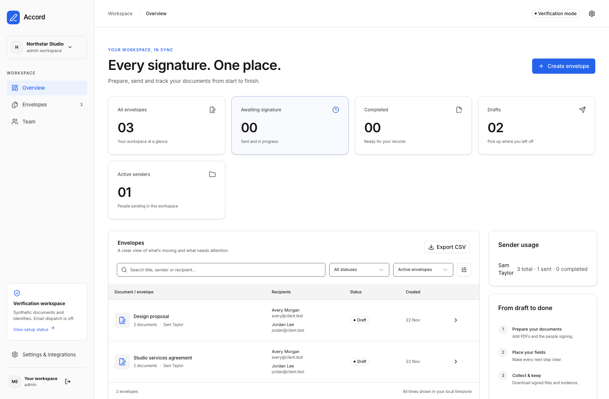
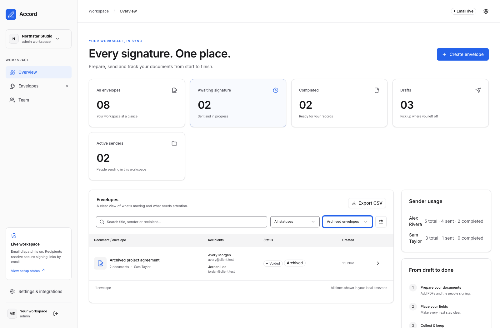
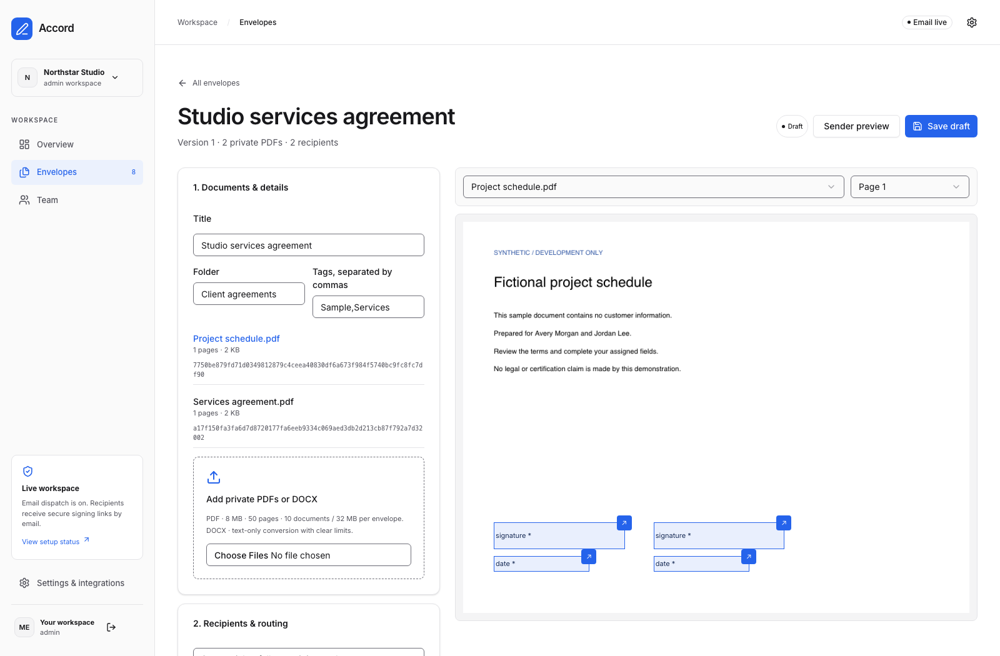

# Accord

A DocuSign-inspired e-signature workspace built by Ibrahim Abdelrahman with [Neander](https://neander.ai).



Upload PDFs, place signature/initial/name/text/checkbox/date fields, route to signers sequentially or in parallel, and track each envelope. Accord includes company roles, contacts, reusable document templates, archived/deleted views, CSV exports, signed PDFs and SHA-256 evidence receipts. Signers use a secure link without creating an account.

This is a reusable Neander template and a standalone Next.js application. Using it in Neander seeds a normal project from a registered source revision with fresh Git history. Normal Publish deploys the app, migrations and fictional sample data; subsequent code changes and republishing follow the regular project workflow. Template updates do not overwrite existing projects.

Accord is not affiliated with DocuSign. [Source provenance](docs/source-provenance.md) identifies the delivered project/revision, including the archived-filter/export fix. No customer records, documents, private accounts, actual signing evidence or provider credentials are included.

## Run locally

Use Node **24.22.3**, pnpm **11.18.0**, and Docker for PostgreSQL. Runtime pins are in `mise.toml`.

```sh
corepack enable
pnpm install --frozen-lockfile
cp .env.example .env.local
docker compose -p accord-dev -f compose.dev.yaml up -d --wait
set -a
. ./.env.local
set +a
pnpm db:migrate
pnpm db:seed
pnpm dev
```

Open <http://127.0.0.1:3000/login>. The fictional company is Northstar Studio:

| Role | Email |
| --- | --- |
| Administrator | `admin@accord.test` |
| Sender | `sender@accord.test` |
| Viewer | `viewer@accord.test` |

All three use `DEMO_PASSWORD`: the local example is `Accord-demo-2026!`. Neander generates a separate value for each deployment; its project owner uses the configured deployment value. Use your own staff identities/passwords before adding real documents.

Explore the two draft agreements, their fictional PDFs/recipients/fields, and contacts. **Show → Archived envelopes** displays the fictional voided agreement; **Export CSV** follows the selected visibility and filters. That archived example contains no signatures or delivered signing requests. Sample initialization is transactional: repeated `pnpm db:seed` preserves the entire existing sample company, passwords, documents and subsequent edits.

Stop only this project's local database with `docker compose -p accord-dev -f compose.dev.yaml down`; omit `--volumes` to retain its data.

## Publishing and integrations

`.neander/compose.yaml` is the canonical production recipe. It uses PostgreSQL/Neon, committed `nextjs-drizzle` migrations and the standalone production image. Migration and template seeding run as explicit setup steps, not every time the web process starts.

| Setting | Source/purpose |
| --- | --- |
| `DATABASE_URL`, `BETTER_AUTH_URL` | Provisioned database and public app origin |
| `BETTER_AUTH_SECRET` | Generated; keep stable because it also encrypts stored secrets |
| `COMPANY_SETUP_KEY`, `DEMO_PASSWORD` | Generated independently per deployment |
| `RESEND_API_KEY` or `BREVO_API_KEY`, `EMAIL_FROM`, `EMAIL_DISPATCH_ENABLED=1` | Your own email provider and verified sender |
| `JOB_TICK_SECRET` | Your own scheduler secret, at least 32 characters |
| `WEBHOOK_DISPATCH_ENABLED=1` | Enable your configured company webhooks |
| `TRUST_PROXY_IP=1` | Enable only with a trusted deployment proxy |

Email and webhook dispatch remain off until configured. Synthetic `.test` recipients are never sent real emails. Invitations, recovery and real signing invitations require your provider configuration. No provider account or scheduler job is inherited or provisioned.

The app processes reminders, expiry, retention and queues while its web process has CPU. Scale-to-zero hosting requires an owner-controlled timer to POST `/api/jobs/tick` every 30 minutes with `Authorization: Bearer <JOB_TICK_SECRET>`. Job/delivery outcomes appear in Settings & integrations. Existing delivered app jobs and credentials are not reused. See [operations](docs/operations.md).

The login page's company-setup flow is for an empty database before its first company exists. Template initialization creates a sample company, so manage/invite staff within that company afterward. `COMPANY_SETUP_KEY` is not an account password.

## Document conversion limits

PDF uploads preserve the supplied presentation. DOCX is converted to A4 PDF with basic paragraphs/headings, table grids and column widths, horizontal cell spans, list text and explicit page breaks.

DOCX does **not** reproduce images/charts/shapes/text boxes; headers/footers/footnotes; bold/italic/underline, fonts, sizes or colours; paragraph alignment/custom indentation; row-merged cells; multiple columns/comments; clickable links (text only); or exact pagination apart from explicit breaks. Use a PDF exported from Word when presentation must be preserved.

Unsupported non-Western scripts, unaccepted tracked deletions, embedded objects and files over **8 MB or 50 pages** are refused. Western European accented signing text is supported; other scripts are refused when the PDF fonts cannot render them. These limits are part of the delivered product, not full Word fidelity.

Accord records consent, timestamps, signatures and digests, but has no certification against legal e-signature standards. The deployment owner is responsible for its use and compliance requirements.

## Verify changes

```sh
pnpm check
pnpm test
pnpm build
```

Run `pnpm test:integration` only against a separately migrated disposable PostgreSQL database with `TEAM_ESIGN_DEV_DATABASE=1`. The original suite creates synthetic fixtures and checks real password sessions, company/role boundaries, both signing routes, evidence integrity, templates, jobs, lifecycle and setup. It does not use the delivered client database. A recovery drill is available via `pnpm recovery:verify`; its documented development restrictions apply.

`pnpm test:template` requires the shared verifier's disposable database, built `NEANDER_TEMPLATE_IMAGE` and generated environment. It checks real browser login/PDF rendering, seeded content, archived-filter CSV behavior, permissions, retry-preserving seeding and edit persistence across a container restart.

Public GitHub CI runs app tests/integration and native Linux/amd64 image verification without cloud credentials. Neander's existing private publisher additionally verifies the exact committed source and publishes images/catalog metadata. Private publishing tooling is not in this repository. See [verification scope](docs/team-esignature-status.md).

## Screenshots




## License

MIT. Third-party UI foundation notices remain in [public/neander-foundation-LICENSE.txt](public/neander-foundation-LICENSE.txt).

## Security

See [SECURITY.md](SECURITY.md) for private vulnerability reporting and the automated security checks.
